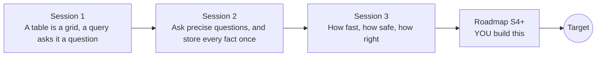

# opensql

[](https://github.com/KrunalPanchal1995/opensql/actions/workflows/ci.yml)   [](https://colab.research.google.com/github/KrunalPanchal1995/opensql/blob/main/sessions/session-01/lesson.ipynb) [](https://krunalpanchal1995.github.io/opensql/)

**Ask a database a question, then design its tables, in three sessions.**

opensql teaches databases with Python's built-in sqlite3: tables, queries, keys, joins, indexes and transactions, every answer checked against plain Python.

- **Start from zero.** Session 1 needs only the idea of a spreadsheet; SQL is explained one word at a time.
- **Nothing to install.** sqlite3 ships with Python and every database lives in memory, so nothing can be damaged.
- **Know you got it right.** Each session ends with a checkpoint that compares every query with a plain Python computation.
- **Build the missing half.** The repo stops at Session 3 on purpose; the roadmap shows the path to the Target.

[Target](#the-target) · [Who is this for](#who-is-this-for) · [Quick start](#quick-start) · [Sessions](#sessions) · [Roadmap](#roadmap) · [Contribute](#contribute) · [Explainer PDF](docs/explainer.pdf)

> **This repo is incomplete on purpose.** Sessions 1 to 3 are here and fully working. The finished Target below is a preview of what the community can build next. We show you the path, not the code. Sessions 4 and up are yours.

## The Target

An animated query being answered, in three acts. First a filter sweeps down a table and rows light up as they pass. Then a join draws lines from each order to its customer. Finally a race: a full scan crawls through 200,000 rows while an index lookup finishes in a few steps, with a timing chart (illustrative) at the end. Your goal over the coming sessions: build that query visualiser yourself.


*Target: a filter, a join and a scan-versus-index race, animated*


*Still from the Target: the scan-versus-index race and its timing chart*

Try it live:

- [Math Visual Studio (Studio root)](https://krunalpanchal1995.github.io/studio/)

How the Target was made is shown only as a path in [promo/roadmap.md](promo/roadmap.md).

## Who is this for
**secondary school to diploma / undergraduate (levels 3-5).** Topic area: Computer Science, Programming and Software.

Prerequisites:

- Having used a spreadsheet: rows, columns, sorting and filtering.
- Python 3.10 or newer; if `python --version` works, you are ready. PRIMER.md explains the rest.
- No prior SQL, GitHub or database experience is needed. All data are synthetic.

New to Python? Read [PRIMER.md](PRIMER.md) first (10 minutes).

## Quick start

No installation knowledge needed. You need [Git](https://git-scm.com/downloads) and [Python 3.10+](https://www.python.org/downloads/) (Windows: tick "Add Python to PATH"). On Mac and Linux type `python3` wherever this page says `python`.

```bash
git clone https://github.com/KrunalPanchal1995/opensql.git
cd opensql
python start.py 1
```

`start.py` creates a private environment, installs what is needed and runs Session 1 with its checkpoint. Next: `python start.py 2`, `python start.py 3`, or `python start.py test` to check everything. Only a checkpoint: `python start.py check 1`.

Five lines turn the idea of Session 1 into a result (they work as they are): Save it as `try.py` and run it with `python start.py run try.py` (this uses the private environment, where NumPy is installed):

```python
import sqlite3
db = sqlite3.connect(":memory:")                      # a database that lives in RAM
db.execute("CREATE TABLE t (name TEXT, marks INTEGER)")
db.executemany("INSERT INTO t VALUES (?, ?)", [("Asha", 72), ("Bilal", 45), ("Chitra", 88)])
print(db.execute("SELECT name FROM t WHERE marks >= 60 ORDER BY marks DESC").fetchall())   # -> [('Chitra',), ('Asha',)]
```

Every session also opens in your browser with sliders (no install): [live apps](https://krunalpanchal1995.github.io/opensql/). Or use the Colab badge above for the notebook.

## Sessions

| # | Session | Model level | Time | Live app |
|---|---|---|---|---|
| 1 | [A table is a grid, a query asks it a question](sessions/session-01/README.md) | Level 1: conceptual interactive model | 60 min | [open](https://krunalpanchal1995.github.io/opensql/session-01/) |
| 2 | [Ask precise questions, and store every fact once](sessions/session-02/README.md) | Level 2: mathematical engineering model | 80 min | [open](https://krunalpanchal1995.github.io/opensql/session-02/) |
| 3 | [How fast, how safe, how right](sessions/session-03/README.md) | Level 3: simulation and validation | 90 min | [open](https://krunalpanchal1995.github.io/opensql/session-03/) |

Each session follows the same six steps: A real-world problem, B concept and theory, C visual explanation, D interactive simulation, E worked example and experiment, F assessment and design challenge. Each ends with `checkpoint.py`, which prints `PASS` or `FAIL` against reference numbers. Session 3 also contains the real-world mini-project: **Schema and three reports for a small canteen**.

## Architecture



| Folder or file | What is inside |
|---|---|
| `sessions/` | three sessions: README (A-F), `lesson.py`, notebook, live app, exercises, activity sheet, checkpoint |
| `promo/` | the Target: media, live links, and the roadmap (path only) |
| `docs/` | `explainer.tex` and the built `explainer.pdf` |
| `tests/` | runs every lesson and checkpoint headless |
| `start.py` | one command to set up and run anything |
| `QUALITY.md`, `RUBRIC.md` | the quality checklist and the scoring rubric |
| `.github/` | CI, PDF build, Pages deploy, issue and PR templates |

## Roadmap

| Milestone | What you will build | Difficulty |
|---|---|---|
| Session 4: Composite and covering indexes | A query tuned with the right composite index, with before-and-after plans. | intermediate |
| Session 5: Window functions and running totals | A canteen report with a running revenue column per customer. | intermediate |
| Session 6: Messy spreadsheet to third normal form | A script that loads a 1,000-row flat order file and builds customers, items and orders tables. | intermediate |
| Session 7: Concurrency and the write-ahead log | Several threads transferring money at the same time against one file database. | advanced |
| Session 8: A tiny B-tree and the query visualiser | Your own B-tree with insert and search, drawn step by step, plus a visualiser like the Target. | advanced |

Full detail with a checkpoint per milestone: [promo/roadmap.md](promo/roadmap.md).

## Contribute
New to GitHub? Read [CONTRIBUTING.md](CONTRIBUTING.md); it starts from zero. Pick an issue labelled `good first issue`. Translations into Hindi, Telugu, Tamil and Malayalam are welcome.

<details>
<summary>Development</summary>

```bash
python start.py test        # runs every lesson and checkpoint
```
Lessons use `# %%` cell markers so they open as notebooks in VS Code. See [QUALITY.md](QUALITY.md) for the standard every session meets.
</details>

## License
MIT. See [LICENSE](LICENSE). Media in `promo/media` is (c) Krunal Panchal, CC BY 4.0.

## Acknowledgments
Part of the [PAN IIT OSS](https://hellofoss.tech-iitb.org/projects) open-source teaching collection, modelled on the structure of [openspline](https://github.com/openspline/openspline). Built on ideas from the Math Visual Studio at https://krunalpanchal1995.github.io/studio/.
