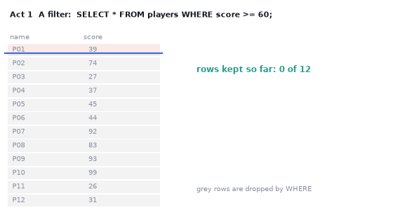
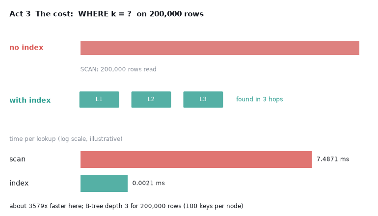

# What you are building toward

An animated query being answered, in three acts. First a filter sweeps down a table and rows light up as they pass. Then a join draws lines from each order to its customer. Finally a race: a full scan crawls through 200,000 rows while an index lookup finishes in a few steps, with a timing chart (illustrative) at the end. Your goal over the coming sessions: build that query visualiser yourself.

*Target: a filter, a join and a scan-versus-index race, animated*

*Still from the Target: the scan-versus-index race and its timing chart*

These results come from a private reference build. The code is not published; the roadmap shows the path so you can build your own.

Live links:

- [Math Visual Studio (Studio root)](https://krunalpanchal1995.github.io/studio/)
