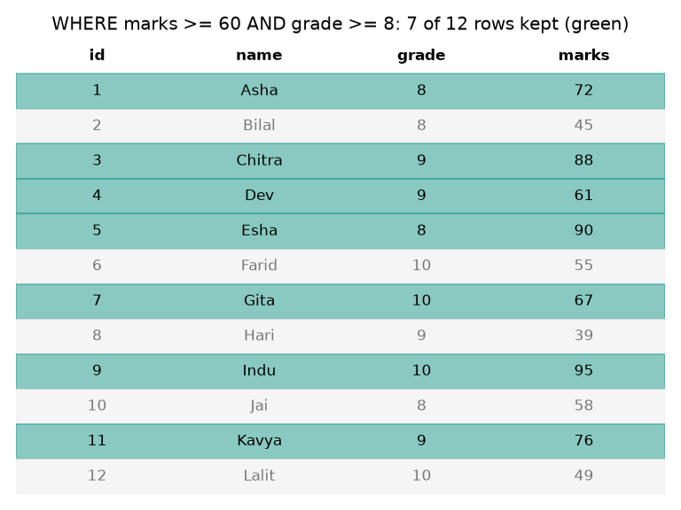
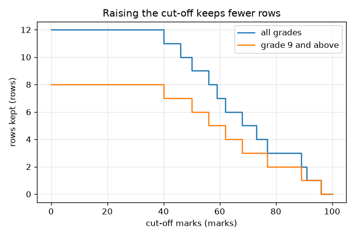

# സെഷൻ 1: ഒരു ടേബിൾ (Table) എന്നത് ഒരു ഗ്രിഡാണ് (Grid), ഒരു ക്വറി (Query) അതിനോട് ചോദ്യം ചോദിക്കുന്നു

*ലെവൽ 1 (ആശയപരമായ സംവാദാത്മക മോഡൽ) · ഏകദേശം 60 മിനിറ്റ് · opensql*

> ഇതൊരു ലളിതമാക്കിയ വിദ്യാഭ്യാസ മാതൃകയാണ് (educational model). ഇതൊരു സാക്ഷ്യപ്പെടുത്തിയ ഡിസൈൻ ടൂളല്ല കൂടാതെ തത്സമയ നിർമ്മിതികൾ, ഇലക്ട്രിക്കൽ ഇൻസ്റ്റാളേഷനുകൾ, വാഹനങ്ങൾ, വ്യാവസായിക പ്രക്രിയകൾ അല്ലെങ്കിൽ മെഡിക്കൽ തീരുമാനങ്ങൾ എന്നിവയ്ക്കായി ഇത് ഉപയോഗിക്കാൻ പാടില്ല.

**മുൻകൂർ ആവശ്യകതകൾ (Prerequisites)**

- സ്പ്രെഡ്ഷീറ്റ് (spreadsheet) ഉപയോഗിച്ചുള്ള പരിചയം: റോകളും (rows) കോളങ്ങളും (columns).
- നിങ്ങൾ PRIMER.md വായിക്കുകയും `python start.py 1` ഒരു തവണ പ്രവർത്തിപ്പിക്കുകയും ചെയ്തിരിക്കണം.

**പഠന ലക്ഷ്യങ്ങൾ (Learning objectives).** ഈ സെഷന് ശേഷം നിങ്ങൾക്ക് സാധിക്കുന്നത്:

- ഒരു ടേബിളിനെ റോകൾ (rows) (റെക്കോർഡുകൾ, records), കോളങ്ങൾ (columns) (ഫീൽഡുകൾ, fields) എന്നിവയായി വിവരിക്കാൻ.
- ഒരു `SELECT ... FROM ... WHERE` ക്വറി വായിക്കാനും എഴുതാനും.
- ഒരു ഫിൽട്ടർ(filter) എത്ര റോകളെ നിലനിർത്തുമെന്ന് പ്രവചിക്കാനും, അത് സാധാരണമായ Python ആയിട്ട്  ഒത്തുനോക്കാനും.
- കട്ട്-ഓഫിന് (cut-off) എതിരായി നിലനിർത്തിയ റോകളുടെ ഗ്രാഫ് വായിക്കാൻ.

## A. യഥാർത്ഥ ലോകത്തിലെ പ്രശ്നം (Real-world problem)

ഒരു സ്കൂളിൽ നൂറുകണക്കിന് വിദ്യാർത്ഥികളുടെ മാർക്കുകൾ സൂക്ഷിക്കുന്നു. "ആർക്കൊക്കെ കുറഞ്ഞത് 60 മാർക്ക് കിട്ടി?" അല്ലെങ്കിൽ "ആരൊക്കെയാണ് ഗ്രേഡ് 9 അല്ലെങ്കിൽ അതിനുമുകളിലുള്ളവർ, കൂടാതെ കുറഞ്ഞത് 70 മാർക്ക് നേടിയവർ?" എന്ന് അധ്യാപകൻ ചോദിക്കുന്നു. ഓരോ റോയും എടുത്ത് വായിക്കാൻ ആരും ആഗ്രഹിക്കുന്നില്ല. ഒരു ഡാറ്റാബേസ് (database) ഡാറ്റയെ ഒരു ടേബിളിൽ സൂക്ഷിക്കുന്നു, ഒരു ക്വറി (query) നമുക്കായി ആ ചോദ്യം ചോദിക്കുന്നു. ഒരു കമ്പ്യൂട്ടറിന് ഉത്തരം നൽകാൻ കഴിയുന്ന തരത്തിൽ ചോദ്യം എങ്ങനെ എഴുതാം, ഉത്തരം ശരിയാണെന്ന് എങ്ങനെ അറിയാം? (ഇവിടെയുള്ള എല്ലാ പേരുകളും മാർക്കുകളും നിർമ്മിതമാണ് (synthetic).)

## B. ആശയവും സിദ്ധാന്തവും (Concept and theory)

ഒരു ടേബിൾ എന്നത് ഒരു ഗ്രിഡാണ്. ഓരോ റോയും ഓരോ റെക്കോർഡാണ് (ഒരു വിദ്യാർത്ഥി), ഓരോ കോളവും ഓരോ വിവരമാണ് (പേര്, ഗ്രേഡ്, മാർക്ക്). ടേബിളിനോട് ചോദിക്കുന്ന ഒരു ചോദ്യമാണ് ക്വറി (query).
SQL-ൽ:

- `SELECT` എന്നത് ഏതൊക്കെ കോളങ്ങൾ കാണിക്കണമെന്ന് വ്യക്തമാക്കുന്നു.
- `FROM` എന്നത് ഏത് ടേബിളാണെന്ന് വ്യക്തമാക്കുന്നു.
- `WHERE` എന്നത് ഒരു നിബന്ധന (condition) ശരിയാകുന്ന റോകളെ മാത്രം നിലനിർത്തുന്നു; മറ്റുള്ളവ ഒഴിവാക്കപ്പെടുന്നു.

ഒരു ക്വറി ഡാറ്റ വായിക്കുക മാത്രമേ ചെയ്യുന്നുള്ളൂ, അത് ഒരിക്കലും ടേബിളിൽ മാറ്റം വരുത്തുന്നില്ല. നിബന്ധനകൾ താരതമ്യങ്ങൾ ചെയ്യാൻ (`>=`, `>`, `=`) ഉപയോഗിക്കുന്നു, കൂടാതെ ഇവയെ `AND` (രണ്ടും ശരിയാകണം) അല്ലെങ്കിൽ `OR` (ഏതെങ്കിലും ഒന്ന് ശരിയായാൽ മതി) എന്നിവ ഉപയോഗിച്ച് ബന്ധിപ്പിക്കാം. ഒരു സ്വതന്ത്ര കമ്പ്യൂട്ടേഷൻ ഉപയോഗിച്ച് (ഇവിടെ ഒരു Python ലിസ്റ്റ് കോംപ്രിഹെൻഷനും നംപൈ മാസ്കും - numpy mask) നമ്മൾ എപ്പോഴും ക്വറി പരിശോധിക്കുന്നു.

| ചിഹ്നം (Symbol) | അർത്ഥം (Meaning)                                | യൂണിറ്റ് (Unit) |
| --------------- | ----------------------------------------------- | --------------- |
| m               | `marks >= m` എന്ന നിബന്ധനയിലെ മാർക്ക് കട്ട്-ഓഫ് | മാർക്ക് (marks) |
| g               | `grade >= g` എന്ന നിബന്ധനയിലെ ഗ്രേഡ് കട്ട്-ഓഫ്  | ഗ്രേഡ് (grade)  |
| n_kept          | ഫിൽട്ടർ പാസാകുന്ന റോകളുടെ എണ്ണം                 | റോകൾ (rows)     |
| N               | ടേബിളിലെ ആകെ റോകളുടെ എണ്ണം (12)                 | റോകൾ (rows)     |

**ധാരണകൾ (Assumptions)**

- ഡാറ്റ നിർമ്മിതമാണ് (synthetic): 12 സാങ്കൽപ്പികമായ വിദ്യാർത്ഥികൾ.
- ഓരോ റോയ്ക്കും ഒരു സവിശേഷമായ ID ഉണ്ട് (Session 2-ൽ വിശദീകരിക്കുന്ന primary key).
- ഡാറ്റാബേസ് മെമ്മറിയിലാണ് പ്രവർത്തിക്കുന്നത് (`sqlite3` with `:memory:`), കൂടാതെ പ്രോഗ്രാം അവസാനിക്കുമ്പോൾ നശിക്കുകയും ചെയ്യുന്നു.

$$ n_{\text{kept}}=\left|\{\,r : \text{marks}(r)\ge m \ \wedge\ \text{grade}(r)\ge g\,\}\right| $$

$$ \text{percent kept}=100\,\frac{n_{\text{kept}}}{N} $$

## C. ദൃശ്യപരമായ വിശദീകരണം (Visual explanation)

ആദ്യത്തെ ചിത്രം 12-റോ ടേബിൾ കാണിക്കുന്നു. ഇതിൽ 'marks >= 60 AND grade >= 8' പാസാകുന്ന റോകൾ പച്ചനിറത്തിലും നിരസിക്കപ്പെട്ട റോകൾ ചാരനിറത്തിലും കാണിച്ചിരിക്കുന്നു: 12-ൽ 7 റോകൾ ബാക്കിയാകുന്നു.

രണ്ടാമത്തെ ചിത്രം കട്ട്-ഓഫിന് എതിരായി നിലനിർത്തിയ റോകളുടെ എണ്ണം പ്ലോട്ട് ചെയ്യുന്നു. കട്ട്-ഓഫ് ഉയരുമ്പോൾ ഇത് താഴേക്ക് മാത്രം പോകുന്ന ഒരു സ്റ്റെയർകേസ് (staircase) ഗ്രാഫാണ്, കാരണം കൂടുതൽ കർശനമായ നിബന്ധനയ്ക്ക് കൂടുതൽ റോകളെ നിലനിർത്താൻ കഴിയില്ല; രണ്ടാമത്തെ കർവ് (ഗ്രേഡ് 9-ഉം അതിനുമുകളിലും) ആദ്യത്തേതിന് താഴെയായി സ്ഥിതിചെയ്യുന്നു.

*12-റോ ടേബിളിൽ 'marks >= 60 AND grade >= 8' പാസാകുന്ന റോകൾ പച്ചനിറത്തിൽ.*

*കട്ട്-ഓഫിന് എതിരായി നിലനിർത്തിയ റോകൾ: കട്ട്-ഓഫ് ഉയരുമ്പോൾ താഴേക്ക് മാത്രം പോകുന്ന ഒരു സ്റ്റെയർകേസ് ഗ്രാഫ്.*

## D. സംവാദാത്മക സിമുലേഷൻ (Interactive simulation)

പാഠം പ്രവർത്തിപ്പിക്കുക (`python start.py 1`), തുടർന്ന് ലൈവ് ആപ്പ് തുറക്കുക: [Session 1: filter a table](https://krunalpanchal1995.github.io/opensql/session-01/) (അല്ലെങ്കിൽ ഈ ഫോൾഡറിലെ `app.html`). മാർക്ക് കട്ട്-ഓഫ്, ഏറ്റവും കുറഞ്ഞ ഗ്രേഡ് സ്ലൈഡറുകൾ നീക്കി റോകൾ പച്ചയോ ചാരനിറമോ ആകുന്നത് കാണുക, കൂടാതെ SQL ടെക്സ്റ്റ് മാറുന്നത് ശ്രദ്ധിക്കുക. തുടർന്ന് ഗ്രാഫ് വ്യൂ തുറന്ന് സ്റ്റെയർകേസ് എവിടെയാണ് താഴേക്ക് വീഴുന്നതെന്ന് കാണുക.

**ചാലഞ്ച് (Challenge).** ഫിൽട്ടർ കൃത്യം 3 റോകൾ മാത്രം നിലനിർത്തുന്ന രീതിയിൽ സജ്ജീകരിക്കുക.

## E. ഉദാഹരണവും പരീക്ഷണവും (Worked example and experiment)

**പ്രശ്നം.** ഈ 12-റോ ടേബിൾ ഉപയോഗിച്ച്, ഗ്രേഡ് 9-ലോ അതിനുമുകളിലോ ഉള്ളവരും കുറഞ്ഞത് 70 മാർക്ക് നേടിയവരുമായ വിദ്യാർത്ഥികൾ ആരൊക്കെയാണ്? തുടക്കത്തിൽ ഗ്രേഡ് 9-ലോ അതിനുമുകളിലോ എത്ര റോകൾ ഉണ്ട്?

1. `grade >= 9` ഉള്ള റോകൾ: Chitra (9), Dev (9), Farid (10), Gita (10), Hari (9), Indu (10), Kavya (9), Lalit (10). അതായത് 8 റോകൾ.
2. അവരിൽ, `marks >= 70`: Chitra 88 അതെ, Dev 61 അല്ല, Farid 55 അല്ല, Gita 67 അല്ല, Hari 39 അല്ല, Indu 95 അതെ, Kavya 76 അതെ, Lalit 49 അല്ല.
3. മൂന്ന് റോകൾ പാസാകുന്നു: Chitra, Indu, Kavya.
4. SQL: `SELECT name FROM students WHERE grade >= 9 AND marks >= 70 ORDER BY id;` അതേ മൂന്ന് പേരുകൾ നൽകുന്നു.

**ഉത്തരം.** Chitra, Indu, Kavya (3 റോകൾ), ഗ്രേഡ് 9 അല്ലെങ്കിൽ അതിനുമുകളിലുള്ള 8 റോകളിൽ നിന്ന് തിരഞ്ഞെടുക്കപ്പെട്ടു.

**പരീക്ഷണം.** 12 റോകൾ ഒരു സ്പ്രെഡ്ഷീറ്റിൽ ടൈപ്പ് ചെയ്യുക, 'marks at least 70, grade at least 9' എന്ന ഫിൽട്ടർ പ്രയോഗിച്ച് ദൃശ്യമാകുന്ന റോകൾ എണ്ണുക; നിങ്ങൾക്ക് 3 ലഭിക്കണം. തുടർന്ന് `python start.py 1` റൺ ചെയ്ത് SQL ഉത്തരവുമായി താരതമ്യം ചെയ്യുക. സ്പ്രെഡ്ഷീറ്റും ഡാറ്റാബേസും യോജിക്കുന്നു കാരണം രണ്ടും ഒരേ നിയമം പ്രയോഗിക്കുന്നു; ദശലക്ഷക്കണക്കിന് റോകൾ ഉള്ളപ്പോൾ, അല്ലെങ്കിൽ ഒരേസമയം നിരവധിയാളുകൾ ഡാറ്റ ഉപയോഗിക്കുമ്പോൾ ഡാറ്റാബേസ് മികച്ചതായി മാറുന്നു.

## F. മൂല്യനിർണ്ണയവും ഡിസൈൻ വെല്ലുവിളിയും (Assessment and design challenge)

**ചോദ്യം തരം A: ആശയപരം.** ഒരു SELECT ക്വറി പ്രവർത്തിപ്പിക്കുന്നത് ടേബിളിൽ മാറ്റം വരുത്തുമോ? ഒരു ഉത്തരത്തിലെ റോകളുടെ ക്രമം നിശ്ചയിക്കാൻ ORDER BY ആവശ്യമുള്ളത് എന്തുകൊണ്ട്?

    
സൂചനകൾ

'വായിക്കുക' (read), 'എഴുതുക' (write) എന്നിവയുടെ അർത്ഥത്തെക്കുറിച്ചും, ഒരു ടേബിൾ ഏതെങ്കിലും പ്രത്യേക ക്രമം ഉറപ്പുനൽകുന്നുണ്ടോ എന്നതിനെക്കുറിച്ചും ചിന്തിക്കുക.

    
പടിപടിയായുള്ള ഉത്തരം

ഇല്ല: SELECT വായിക്കുക മാത്രമേ ചെയ്യുന്നുള്ളൂ. ഡാറ്റ മാറ്റാൻ INSERT, UPDATE അല്ലെങ്കിൽ DELETE ആവശ്യമാണ്. ഒരു ടേബിൾ എന്നത് റോകളുടെ ഒരു ഗണമാണ്, അതിനാൽ ഏതെങ്കിലും പ്രത്യേക ക്രമത്തിൽ അവ തിരികെ നൽകുമെന്ന് വാഗ്ദാനം ചെയ്യുന്നില്ല. ക്രമം പ്രധാനമാണെങ്കിൽ (ഉദാഹരണത്തിന് ഉയർന്ന മാർക്ക് ആദ്യം) നിങ്ങൾ ORDER BY ഉപയോഗിച്ച് അത് പറയണം.

**ചോദ്യം തരം B: ഗണിതപരം.** ഗ്രേഡ് 10-ഉം കുറഞ്ഞത് 50 മാർക്കുമുള്ള എത്ര റോകൾ ഉണ്ട്? അത് മുഴുവൻ ടേബിളിന്റെ എത്ര ശതമാനമാണ്?

    
സൂചനകൾ

ആദ്യം ഗ്രേഡ് 10 ഉള്ള നാല് റോകൾ ലിസ്റ്റ് ചെയ്യുക, തുടർന്ന് `marks >= 50` പ്രയോഗിക്കുക.

    
പടിപടിയായുള്ള ഉത്തരം

ഗ്രേഡ് 10 റോകൾ: Farid 55, Gita 67, Indu 95, Lalit 49. `marks >= 50` എന്നത് Farid, Gita, Indu എന്നിവരെ നിലനിർത്തുന്നു: 3 റോകൾ. ശതമാനം = 100 \* 3 / 12 = 25 ശതമാനം.

**ചോദ്യം തരം C: ഗ്രാഫും സിമുലേഷൻ വിശകലനവും.** എല്ലാ ഗ്രേഡുകൾക്കുമുള്ള സ്റ്റെയർകേസ് ഗ്രാഫിൽ, 90 കട്ട്-ഓഫിൽ എത്ര റോകൾ നിലനിർത്തപ്പെടുന്നു, കൂടാതെ 0 റോകൾ മാത്രം നിലനിർത്തുന്ന ആദ്യത്തെ പൂർണ്ണസംഖ്യാ കട്ട്-ഓഫ് (whole-number cut-off) ഏതാണ്?

    
സൂചനകൾ

90 അല്ലെങ്കിൽ അതിൽ കൂടുതൽ മാർക്ക്: ടേബിളിലെ ഏറ്റവും വലിയ മാർക്കുകൾ നോക്കുക.

    
പടിപടിയായുള്ള ഉത്തരം

`marks >= 90`: Esha 90, Indu 95, അതിനാൽ 2 റോകൾ. ഏറ്റവും ഉയർന്ന മാർക്ക് 95 ആണ്, അതിനാൽ 95 കട്ട്-ഓഫ് 1 റോ നിലനിർത്തുന്നു, 96 ആണ് 0 റോകൾ നിലനിർത്തുന്ന ആദ്യത്തെ കട്ട്-ഓഫ്. 95-ന് തൊട്ടുപിന്നാലെ സ്റ്റെയർകേസ് 0 ആയി താഴുന്നു.

**ചോദ്യം തരം D: ഡിസൈൻ ആൻഡ് ഓപ്റ്റിമൈസേഷൻ(optimisation) ചാലഞ്ച്.** ഡിസൈൻ: ഒരു സ്കോളർഷിപ്പ് ഇന്റർവ്യൂവിൽ മാർക്കിന്റെ അടിസ്ഥാനത്തിൽ 12-ൽ മികച്ച 3 വിദ്യാർത്ഥികളെ (25 ശതമാനം) ഉൾപ്പെടുത്തണം. 'marks >= cut-off' എന്നതിനായി ഒരു കട്ട്-ഓഫ് തിരഞ്ഞെടുക്കുക. ഏതൊക്കെ കട്ട്-ഓഫുകൾ പ്രവർത്തിക്കും, ഏതാണ് നിങ്ങൾ തിരഞ്ഞെടുക്കുക?

    
സൂചനകൾ

ഏറ്റവും ഉയർന്ന മാർക്കുകൾ 95, 90, 88, 76 എന്നിവയാണ്. ആദ്യ മൂന്ന് പേരെ നിലനിർത്താനും നാലാമത്തെയാളെ ഒഴിവാക്കാനും കട്ട്-ഓഫ് എവിടെയായിരിക്കണം?

    
പടിപടിയായുള്ള ഉത്തരം

കട്ട്-ഓഫ് 76-ന് മുകളിലായിരിക്കണം (അല്ലാത്തപക്ഷം കാവ്യയെയും ഉൾപ്പെടുത്തും) കൂടാതെ പരമാവധി 88 ആയിരിക്കണം (അല്ലാത്തപക്ഷം ചിത്രയെ നഷ്ടപ്പെടും). അതിനാൽ പൂർണ്ണസംഖ്യകളായ 77 മുതൽ 88 വരെയുള്ള കട്ട്-ഓഫുകൾ കൃത്യം 3 റോകൾ നിലനിർത്തുന്നു. 80 എന്ന കട്ട്-ഓഫ് ഒരു നല്ല തിരഞ്ഞെടുപ്പാണ്, കാരണം അത് 76-നും 88-നും ഇടയിലുള്ള ഗാപ്പിന്റെ മധ്യത്തിലാണ്, വിശദീകരിക്കാനും എളുപ്പമാണ്.

[RUBRIC.md](../../RUBRIC.md) ഉപയോഗിച്ച് സ്വയം സ്കോർ ചെയ്യുക. പേപ്പറിൽ പരിശീലിക്കാൻ [activity sheet](activity_sheet.md) പ്രിന്റ് ചെയ്യുക.

## പൊതുവായ തെറ്റിദ്ധാരണകൾ (Common misconceptions)

| പൊതുവായ തെറ്റിദ്ധാരണ                                             | യഥാർത്ഥത്തിൽ ശരിയായത്                                                                                                                                   |
| ---------------------------------------------------------------- | ------------------------------------------------------------------------------------------------------------------------------------------------------- |
| ഒരു SELECT ക്വറി ഡാറ്റ മാറ്റുകയോ ഇല്ലാതാക്കുകയോ ചെയ്യുന്നു.      | SELECT ഡാറ്റ വായിക്കുക മാത്രമേ ചെയ്യുന്നുള്ളൂ. INSERT, UPDATE, DELETE എന്നിവയാണ് ഡാറ്റ മാറ്റുന്നത്.                                                     |
| സേവ് ചെയ്ത അതേ ക്രമത്തിലാണ് റോകൾ പുറത്തുവരുന്നത്.                | ഒരു ടേബിളും ഡാറ്റയുടെ ക്രമം വാഗ്ദാനം ചെയ്യുന്നില്ല; ക്രമം ആവശ്യമാണെങ്കിൽ ORDER BY ഉപയോഗിക്കുക.                                                          |
| `>=` ഉം `>` ഉം ഉപയോഗിക്കുന്നത് ഒരു വ്യത്യാസവും ഉണ്ടാക്കുന്നില്ല. | അതിർത്തിയിൽ അവ വ്യത്യാസപ്പെട്ടിരിക്കുന്നു: `marks >= 61` എന്നത് കൃത്യം 61 ഉള്ള ഒരു വിദ്യാർത്ഥിയെ നിലനിർത്തുന്നു, എന്നാൽ `marks > 61` നിലനിർത്തുന്നില്ല. |
| SQL-ന് ഒരു സെർവറും ഇൻസ്റ്റാളേഷനും ആവശ്യമാണ്.                     | Python-ന്റെ ബിൽറ്റ്-ഇൻ `sqlite3` മൊഡ്യൂൾ നിങ്ങളുടെ പ്രോഗ്രാമിനുള്ളിൽ (മെമ്മറിയിലോ ഒരു ഫയലിലോ) പൂർണ്ണമായ SQL ഡാറ്റാബേസ് റൺ ചെയ്യുന്നു.                   |

## പദാവലി (Glossary)

- **table**: ഡാറ്റയുടെ ഒരു ഗ്രിഡ്: റോകൾ റെക്കോർഡുകളും കോളങ്ങൾ ഫീൽഡുകളുമാണ്.
- **row**: ഒരു റെക്കോർഡ്, ഉദാഹരണത്തിന് ഒരു വിദ്യാർത്ഥി.
- **column**: ഓരോ റെക്കോർഡിനും വേണ്ടി സൂക്ഷിച്ചിരിക്കുന്ന ഒരു വിവരം, ഉദാഹരണത്തിന് മാർക്ക്.
- **query**: SQL-ൽ ഡാറ്റാബേസിനോട് ചോദിക്കുന്ന ചോദ്യം.
- **filter**: ഒരു നിബന്ധന ശരിയാകുന്ന റോകളെ മാത്രം ബാക്കിയാക്കുന്നത് (WHERE ഭാഗം).

## അവസാനിപ്പിക്കൽ (Finish)

1. [exercises.md](exercises.md)-ലെ മൂന്ന് കോഡിംഗ് ടാസ്ക്കുകൾ ചെയ്യുക.
2. മാറ്റങ്ങൾ വരുത്തിയ ശേഷം `python start.py 1` വീണ്ടും റൺ ചെയ്യുക. ഇത് ചെക്ക്പോയിന്റിൽ അവസാനിക്കുന്നു; `PASS` എന്ന് പ്രിന്റ് ചെയ്യുമ്പോൾ ടാസ്ക് പൂർത്തിയായി. (ചെക്ക്പോയിന്റ് മാത്രം: `python start.py check 1`.)

അടുത്തത്: [സെഷൻ 2](../session-02/README.md)
