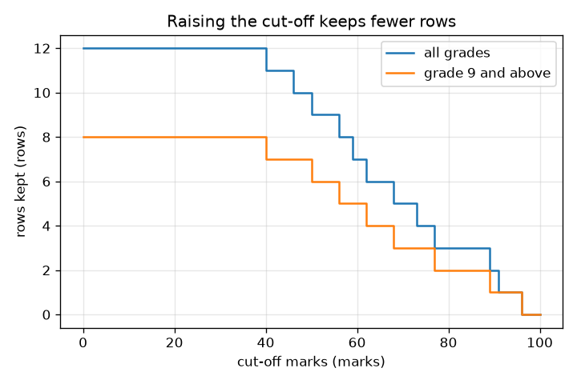
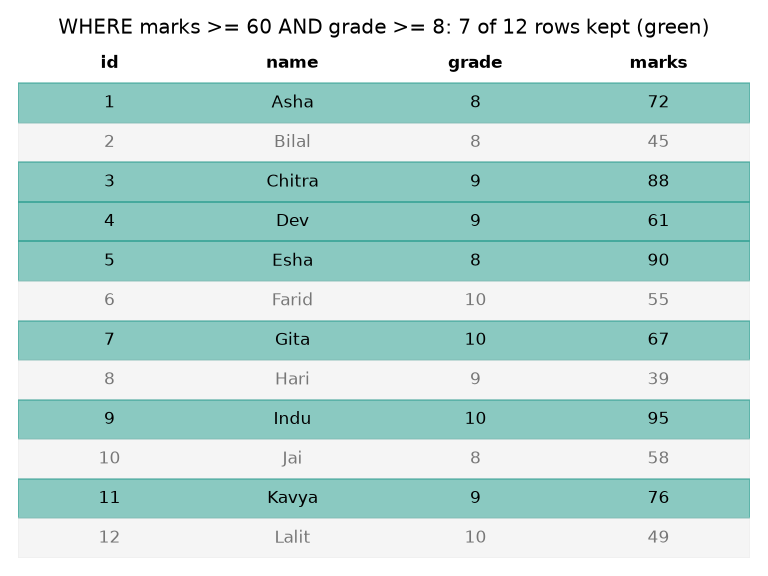

# Session 1: A table is a grid, a query asks it a question

*Level 1 (conceptual interactive model) · about 60 minutes · opensql*

> This is a simplified educational model. It is not a validated design tool and must not be used for real structures, electrical installations, vehicles, industrial processes or medical decisions.

**Prerequisites**

- Having used a spreadsheet: rows and columns.
- You have read PRIMER.md and run `python start.py 1` once.

**Learning objectives.** After this session you can:

- Describe a table as rows (records) and columns (fields).
- Read and write a SELECT ... FROM ... WHERE query.
- Predict how many rows a filter keeps, and check it against plain Python.
- Read a graph of rows kept against the cut-off.

## A. Real-world problem
A school keeps marks for hundreds of students. The teacher asks 'who scored at least 60?' or 'who is in grade 9 or above and scored at least 70?'. Nobody wants to read every row. A database keeps the rows in a table, and a query asks the question for us. How do we write the question so a computer can answer it, and how do we know the answer is right? (All names and marks here are synthetic.)

## B. Concept and theory
A table is a grid. Each row is one record (one student) and each column is one fact (name, grade, marks) stored for every record. A query is a question asked of the table. In SQL, SELECT says which columns to show, FROM says which table, and WHERE keeps only the rows for which a condition is true; the other rows are dropped. A query only reads: it never changes the table. Conditions use comparisons (>=, >, =) and can be joined with AND (both must hold) or OR (either holds). We always check a query against an independent computation, here a Python list comprehension and a numpy mask.

| Symbol | Meaning | Unit |
|---|---|---|
| m | marks cut-off in the condition marks >= m | marks |
| g | grade cut-off in the condition grade >= g | grade |
| n_kept | number of rows that pass the filter | rows |
| N | number of rows in the table (12) | rows |

**Assumptions**

- The data are synthetic: 12 invented students.
- Each row has a unique id (the primary key, explained in Session 2).
- The database lives in memory (sqlite3 with :memory:) and vanishes when the program ends.

$$ n_{\text{kept}}=\left|\{\,r : \text{marks}(r)\ge m \ \wedge\ \text{grade}(r)\ge g\,\}\right| $$

$$ \text{percent kept}=100\,\frac{n_{\text{kept}}}{N} $$

## C. Visual explanation
The first figure draws the 12-row table with the rows that pass 'marks >= 60 AND grade >= 8' in green and the rejected rows in grey: 7 of the 12 rows stay. The second figure plots the number of rows kept against the cut-off. It is a staircase that only goes down as the cut-off rises, because a stricter condition can never keep more rows; the second curve (grade 9 and above) lies below the first.

*Rows kept against the cut-off: a staircase that only falls as the cut-off rises.*

*The 12-row table with the rows that pass 'marks >= 60 AND grade >= 8' in green.*

## D. Interactive simulation
Run the lesson (`python start.py 1`), then open the live app: [Session 1: filter a table](https://krunalpanchal1995.github.io/opensql/session-01/) (or `app.html` in this folder). Move the marks cut-off and the lowest-grade sliders and watch the rows turn green or grey and the SQL text change. Then open the graph view and see where the staircase falls.

**Challenge.** Make the filter keep exactly 3 rows.

## E. Worked example and experiment
**Problem.** Using the 12-row table, which students are in grade 9 or above and scored at least 70? How many rows are in grade 9 or above to begin with?

1. Rows with grade >= 9: Chitra (9), Dev (9), Farid (10), Gita (10), Hari (9), Indu (10), Kavya (9), Lalit (10). That is 8 rows.
2. Of those, marks >= 70: Chitra 88 yes, Dev 61 no, Farid 55 no, Gita 67 no, Hari 39 no, Indu 95 yes, Kavya 76 yes, Lalit 49 no.
3. Three rows pass: Chitra, Indu, Kavya.
4. SQL: SELECT name FROM students WHERE grade >= 9 AND marks >= 70 ORDER BY id; gives the same three names.

**Answer.** Chitra, Indu and Kavya (3 rows), chosen from the 8 rows with grade 9 or above.

**Experiment.** Type the 12 rows into a spreadsheet, apply the filter 'marks at least 70, grade at least 9' and count the visible rows; you should get 3. Then run `python start.py 1` and compare with the SQL answer. The spreadsheet and the database agree because both apply the same rule; the database wins when there are millions of rows, when many people use the data at once, or when the rule must be applied identically by a program every time.

## F. Assessment and design challenge
**Question type A: Conceptual.** Does running a SELECT query change the table? Why does the order of rows in an answer need an ORDER BY?

Hint

Think about what 'read' and 'write' mean, and about whether a table promises any order.

Step-by-step solution

No: SELECT only reads. Changing data needs INSERT, UPDATE or DELETE. A table is a set of rows and does not promise to return them in any particular order, so if the order matters (for example highest marks first) you must say so with ORDER BY.

**Question type B: Numerical.** How many rows have grade 10 and marks of at least 50? What percentage of the whole table is that?

Hint

List the four grade 10 rows first, then apply marks >= 50.

Step-by-step solution

Grade 10 rows: Farid 55, Gita 67, Indu 95, Lalit 49. Marks >= 50 keeps Farid, Gita and Indu: 3 rows. Percentage = 100 * 3 / 12 = 25 percent. Sanity check: 3 is no more than the 4 grade 10 rows.

**Question type C: Graph and simulation interpretation.** On the staircase graph for all grades, how many rows are kept at a cut-off of 90, and what is the first whole-number cut-off that keeps 0 rows?

Hint

Marks of 90 or more: look for the largest marks in the table.

Step-by-step solution

Marks >= 90: Esha 90 and Indu 95, so 2 rows. The largest mark is 95, so a cut-off of 95 keeps 1 row and 96 is the first cut-off that keeps 0 rows. The staircase drops to 0 just after 95.

**Question type D: Design and optimisation challenge.** Design: a scholarship interview should include exactly the top 3 students out of 12 (25 percent) by marks. Choose a cut-off for 'marks >= cut-off'. Which cut-offs work, and which one would you pick?

Hint

The top marks are 95, 90, 88, 76. Where must the cut-off lie to keep the first three but not the fourth?

Step-by-step solution

The cut-off must be above 76 (otherwise Kavya is kept) and at most 88 (otherwise Chitra is lost). So whole-number cut-offs 77 to 88 keep exactly 3 rows. A cut-off of 80 is a sensible choice because it sits in the middle of the gap between 76 and 88 and is easy to explain. Trade-off: with real data, ties at the boundary would make the number of rows jump.

Score yourself with [RUBRIC.md](../../RUBRIC.md). Print the [activity sheet](activity_sheet.md) to work on paper.

## Common misconceptions
| Common misconception | What is actually true |
|---|---|
| A SELECT query changes or deletes data. | SELECT only reads. INSERT, UPDATE and DELETE change data. |
| Rows come out in the order they were stored. | A table does not promise an order; use ORDER BY when order matters. |
| Using >= and > makes no difference. | At the boundary they differ: marks >= 61 keeps a student with exactly 61, marks > 61 does not. |
| SQL needs a server and an installation. | Python's built-in sqlite3 module runs a full SQL database inside your program, in memory or in one file. |

## Glossary
- **table**: a grid of data: rows are records and columns are fields
- **row**: one record, for example one student
- **column**: one fact stored for every record, for example marks
- **query**: a question asked of the database in SQL
- **filter**: keeping only the rows for which a condition is true (the WHERE part)

## Finish
1. Do the three coding tasks in [exercises.md](exercises.md).
2. Run `python start.py 1` again after your changes. It ends with the checkpoint; when it prints `PASS`, you are done. (Checkpoint only: `python start.py check 1`.)

Next: [Session 2](../session-02/README.md)
