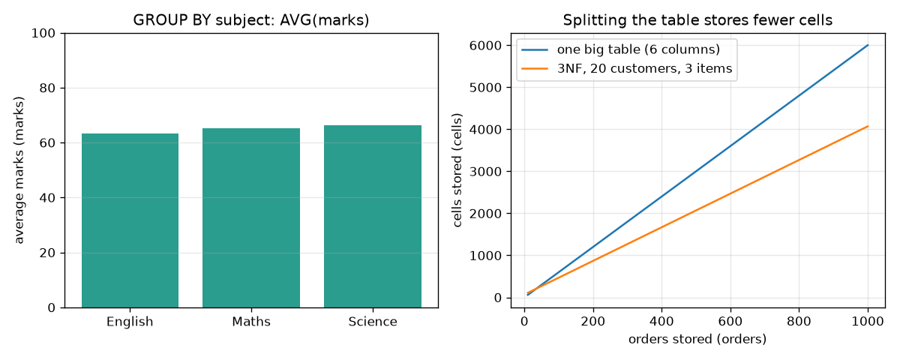

# Session 2: Ask precise questions, and store every fact once

*Level 2 (mathematical engineering model) · about 80 minutes · opensql*

> This is a simplified educational model. It is not a validated design tool and must not be used for real structures, electrical installations, vehicles, industrial processes or medical decisions.

**Prerequisites**

- Session 1: tables, rows, columns and WHERE.
- Averages and sums from school mathematics.

**Learning objectives.** After this session you can:

- Use ORDER BY, LIMIT, COUNT, SUM, AVG, MIN, MAX, GROUP BY and HAVING, and check each against plain Python.
- Explain primary keys and foreign keys, and see the database reject a broken reference.
- Show the update, insert and delete anomalies of one big table.
- Split a table into third normal form and count what is stored.
- Design the tables of a library and write the overdue-loans query.

## A. Real-world problem
A school has 40 students and three subjects: 120 marks. The head teacher wants the best five Science scores, the average per subject, and the students whose average is at least 75. Then a shop owner shows a spreadsheet where every order repeats the customer's city, and asks why one customer ended up in two cities after an edit. Finally a librarian asks for the list of overdue books. How do we ask precisely, and how do we store data so these problems cannot happen?

## B. Concept and theory
Aggregate functions collapse many rows into one number: COUNT counts rows, SUM adds, AVG is SUM divided by COUNT, MIN and MAX pick the extremes. GROUP BY makes one answer row per group. WHERE filters rows before grouping; HAVING filters groups after it. ORDER BY sorts and LIMIT keeps the first few. A primary key identifies each row once. A foreign key is a column whose values must exist in another table's primary key; the database rejects a row that points nowhere (when foreign keys are switched on). One big table that repeats facts (a customer's city on every order) allows anomalies: an update done on only some rows leaves contradictions, a new customer cannot be recorded without an order, and deleting the last order deletes the only record of the customer. Normalisation cures this. 1NF: every cell holds one value. 2NF: every non-key column depends on the whole key. 3NF: no non-key column depends on another non-key column. In the order table, city depends on customer and price depends on item, so we give customers and items their own tables and keep only their keys in orders.

| Symbol | Meaning | Unit |
|---|---|---|
| n | number of orders stored | orders |
| k | number of customers | customers |
| m | number of items on sale (3 here) | items |
| cells | rows times columns, summed over the tables | cells |
| AVG | average of a group of numbers = SUM / COUNT | same unit as the data |

**Assumptions**

- All data are synthetic (invented students, shop and library).
- Each customer name determines one city and each item name one price, so 3NF applies.
- Storage is measured as cells (rows times columns), a simplified measure that ignores text length and index overhead.

$$ \text{AVG}=\frac{\text{SUM}}{\text{COUNT}} $$

$$ \text{cells}_{\text{big}}=6n,\qquad \text{cells}_{\text{3NF}}=4n+3k+3m $$

$$ \text{rows to edit when one customer moves}\approx\frac{n}{k}\ \text{(big table)},\quad 1\ \text{(3NF)} $$

## C. Visual explanation
The figure has two panels. The bar chart shows the average Maths, Science and English mark produced by GROUP BY subject (63.4, 65.2 and 66.2 marks, all close because the data are random). The line chart plots cells stored against the number of orders: the big table grows as 6n, the three tables as 4n + 3k + 9, a shallower line. The lines cross at about 35 orders for 20 customers: below that the extra tables cost more than they save, above it splitting wins.

*Left: GROUP BY subject, average marks. Right: cells stored by the big table (6n) and by three tables (4n + 3k + 9).*

## D. Interactive simulation
Run the lesson (`python start.py 2`), then open the live app: [Session 2: one table or three](https://krunalpanchal1995.github.io/opensql/session-02/) (or `app.html` in this folder). Move the orders and customers sliders and watch the two bars and the two lines. Notice how the number of customers k barely matters when n is large, and how many rows a single city change touches in the big table.

**Challenge.** Find settings where the three tables store less than 70 percent of the cells of the big table.

## E. Worked example and experiment
**Problem.** A six-row table has marks: Maths 70, 90, 80 and Science 60, 50, 85. Use GROUP BY subject to find each subject's sum and average, and use HAVING AVG(marks) > 70 to keep the strong subjects.

1. Maths group: 70 + 90 + 80 = 240; COUNT = 3; AVG = 240 / 3 = 80.
2. Science group: 60 + 50 + 85 = 195; COUNT = 3; AVG = 195 / 3 = 65.
3. HAVING AVG > 70 keeps groups whose average is above 70: Maths (80) stays, Science (65) goes.
4. HAVING is strict, so AVG > 80 would keep nothing, and AVG > 60 would keep both.

**Answer.** Maths: sum 240, average 80, kept. Science: sum 195, average 65, dropped.

**Experiment.** Copy the six marks into a spreadsheet, make a pivot table by subject with sum and average, and compare with the SQL answer. Then take any real list of orders with a repeated customer city, change one city on one row and count how many different cities that customer now has. The model (a clean table) differs from reality because real spreadsheets are edited by many people at different times, which is exactly when contradictions creep in.

## F. Assessment and design challenge
**Question type A: Conceptual.** Why can you not write WHERE AVG(marks) >= 75 to find students whose average is at least 75? What do you write instead?

Hint

When is WHERE applied: before or after the rows are grouped?

Step-by-step solution

WHERE filters individual rows before any grouping, so the average does not exist yet at that point. The average belongs to a group, so the condition goes after the grouping, in HAVING: SELECT student_id, AVG(marks) FROM scores GROUP BY student_id HAVING AVG(marks) >= 75. In the synthetic school data this returns 8 students.

**Question type B: Numerical.** A shop has 500 orders and 10 customers and sells 3 items. How many cells does the big table store, how many do the three tables store, and what percentage is that?

Hint

Use 6n for the big table and 4n + 3k + 3m for the three tables.

Step-by-step solution

Big table: 6 * 500 = 3000 cells. Three tables: 4 * 500 + 3 * 10 + 3 * 3 = 2000 + 30 + 9 = 2039 cells. Percentage = 100 * 2039 / 3000 = 68.0 percent. Sanity check: the orders table has 4 of the 6 columns, so the result must be close to 4/6 = 67 percent, and it is. The real gain is not space but safety from anomalies.

**Question type C: Graph and simulation interpretation.** In the line chart with k = 20 customers and 3 items, between which two numbers of orders do the lines cross? What does that tell a designer?

Hint

Solve 6n = 4n + 3k + 9 for n.

Step-by-step solution

6n = 4n + 69 gives n = 34.5. At 34 orders the big table is smaller (204 against 205 cells); at 35 orders the three tables are smaller (209 against 210). So the lines cross between 34 and 35 orders. For tiny data the split costs a little extra, so the reason to normalise is consistency, and the storage saving appears as the data grow.

**Question type D: Design and optimisation challenge.** Design: a library lends books to members. Design the tables with keys, and write the query that lists loans that are overdue today (still out and due before today), with the member name, the title and the days late.

Hint

A member borrows many books over time and a book is borrowed by many members over time, so the link needs its own table with two foreign keys. A loan that has not come back has no return date (NULL).

Step-by-step solution

Tables: books(book_id PK, title), members(member_id PK, name), loans(loan_id PK, book_id FK to books, member_id FK to members, loaned_on, due_on, returned_on, where returned_on is NULL while the book is out). Query: SELECT l.loan_id, m.name, b.title, julianday(today) - julianday(l.due_on) AS days_late FROM loans l JOIN books b ON b.book_id = l.book_id JOIN members m ON m.member_id = l.member_id WHERE l.returned_on IS NULL AND l.due_on < today. In the sample data with today = 2026-03-10 two loans are overdue: Anita's Malgudi Days (4 days) and Dinesh's Godan (25 days). A loan due today is not yet overdue, and a book returned late is not currently overdue.

Score yourself with [RUBRIC.md](../../RUBRIC.md). Print the [activity sheet](activity_sheet.md) to work on paper.

## Common misconceptions
| Common misconception | What is actually true |
|---|---|
| WHERE and HAVING are the same thing. | WHERE filters rows before grouping; HAVING filters groups after it, so only HAVING can use aggregates such as AVG. |
| Foreign keys are always enforced. | In SQLite you must run PRAGMA foreign_keys = ON on each connection; otherwise a loan for a missing book is silently accepted. |
| Normalising always saves space. | With very few rows the extra tables cost slightly more; the lasting benefit is that each fact is stored once, so edits cannot contradict each other. |
| NULL is a value like 0 or an empty string. | NULL means 'no value'. Test it with IS NULL, never with = NULL. |

## Glossary
- **aggregate**: a function such as COUNT, SUM, AVG, MIN or MAX that turns many rows into one number
- **GROUP BY**: makes one result row for each distinct value of a column
- **primary key**: a column whose value identifies each row exactly once
- **foreign key**: a column whose values must exist in another table's primary key
- **normalisation**: splitting tables so that each fact is stored once
- **anomaly**: a contradiction or loss caused by repeated data: update, insert or delete
- **NULL**: the marker for 'no value'

## Finish
1. Do the three coding tasks in [exercises.md](exercises.md).
2. Run `python start.py 2` again after your changes. It ends with the checkpoint; when it prints `PASS`, you are done. (Checkpoint only: `python start.py check 2`.)

Next: [Session 3](../session-03/README.md)
