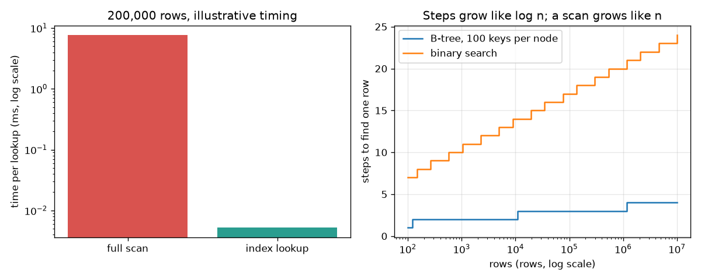

# Session 3: How fast, how safe, how right

*Level 3 (simulation and validation) · about 90 minutes · opensql*

> This is a simplified educational model. It is not a validated design tool and must not be used for real structures, electrical installations, vehicles, industrial processes or medical decisions.

**Prerequisites**

- Session 1: tables and WHERE.
- Session 2: keys, GROUP BY and the idea of splitting tables.

**Learning objectives.** After this session you can:

- Write inner and left JOINs and check them against nested loops.
- Read EXPLAIN QUERY PLAN and measure a scan against an index lookup on 200,000 rows.
- Compute B-tree depth for a given number of rows and keys per node.
- Use a transaction so a failed transfer changes nothing.
- Show why string-built queries are unsafe and fix them with parameters.
- Explain two failure cases: a missing index on a join column, and a foreign key violation.

## A. Real-world problem
A shop database holds 200,000 rows. One query finds a customer's orders in a blink and another makes the page hang. A transfer between two accounts must never lose money, even if the power fails half-way. And a search box must never let a visitor's text become part of the program. What do we measure to know a query is fast, what guarantees a transfer, and what makes a query safe?

## B. Concept and theory
A JOIN pairs rows of two tables whose key columns match; it is a nested loop with a condition. An inner join keeps only matched pairs, a left join also keeps unmatched rows of the left table, filling the other side with NULL. Without an index the database must scan every row to find a match, so the cost grows in proportion to the number of rows n. An index is a sorted structure (a B-tree) kept beside the table. Each B-tree node holds up to B keys, so each step down divides the remaining rows by about B and the number of levels d is the smallest d with B^d >= n. A transaction groups statements so they all happen (COMMIT) or none do (ROLLBACK); a transfer therefore conserves the total money. A query built by gluing text into SQL lets the text change the query's meaning (SQL injection); parameters (?) keep data and SQL separate. Timings depend on the computer and are illustrative; plans, step counts and results are exact.

| Symbol | Meaning | Unit |
|---|---|---|
| n | number of rows in the table | rows |
| B | keys per B-tree node | keys |
| d | levels of the B-tree = steps to find one row | levels |
| steps | virtual-machine instructions run by SQLite for one query | steps |
| T | total money in all accounts | rupees |

**Assumptions**

- All data are synthetic and every database is in memory.
- The B-tree is idealised: every node is full, so the depth formula is a best case.
- Wall-clock times vary between computers and runs; only their size ratio is claimed.
- The injection demo uses our own throw-away database and shows the defence only.

$$ d=\min\{\,d\ge 1 : B^{d}\ge n\,\}\approx\left\lceil \frac{\log n}{\log B}\right\rceil $$

$$ \text{binary search comparisons}=\lceil \log_2 n\rceil $$

$$ \text{cost}_{\text{scan}}\propto n,\qquad \text{cost}_{\text{index}}\propto \log_B n $$

$$ T_{\text{before}}=T_{\text{after}}\quad\text{for every committed or rolled-back transfer} $$

## C. Visual explanation
The figure has two panels. The left bar chart (log scale) compares the measured time per lookup for a full scan and an index lookup on 200,000 rows; the bars differ by a large factor. The right chart plots steps to find one row against the number of rows (log scale): the B-tree with 100 keys per node climbs to only 3 levels by one million rows, binary search to 20, while a scan would need up to a million steps. The curves are staircases because the depth is a whole number.

*Left: time per lookup on 200,000 rows, scan versus index (log scale, illustrative). Right: steps to find one row, B-tree versus binary search.*

## D. Interactive simulation
Run the lesson (`python start.py 3`), then open the live app: [Session 3: how deep is the tree](https://krunalpanchal1995.github.io/opensql/session-03/) (or `app.html` in this folder). Move the rows and keys-per-node sliders in the app. Watch the tree gain a level when the rows pass B, B squared, B cubed, and compare the B-tree line with binary search.

**Challenge.** Make a table of 200,000 rows searchable in only 2 levels.

## E. Worked example and experiment
**Problem.** A table has 1,000,000 rows and each B-tree node holds 100 keys. How many levels does an index lookup need, how many comparisons does binary search need, and how many rows might a scan read?

1. Levels: find the smallest d with 100^d >= 1,000,000. 100^1 = 100, 100^2 = 10,000, 100^3 = 1,000,000. So d = 3.
2. Binary search halves the range each time: 2^19 = 524,288 < 1,000,000 <= 2^20 = 1,048,576, so 20 comparisons.
3. A scan reads the rows one by one: up to 1,000,000.
4. One more row (1,000,001) already needs 4 levels, because 100^3 is exactly 1,000,000.

**Answer.** 3 levels for the B-tree, 20 comparisons for binary search, up to 1,000,000 rows for a scan.

**Experiment.** Run the lesson: it builds a table of 200,000 rows, shows 'SCAN big' for the lookup, creates the index, then shows 'SEARCH big USING INDEX'. Count SQLite's steps (a scan takes hundreds of thousands, the index lookup a few dozen) and time 20 lookups. The step counts are exact and repeatable; the clock times are not, because your computer, its cache and other programs change them. The model also assumes full nodes, while real B-trees are partly empty and read disk pages, so real depth is a little larger.

## Real-world application and mini-project: Schema and three reports for a small canteen
A school canteen sells six items to eight regular customers. Session 3 provides the synthetic data (`CANTEEN_ITEMS`, `CANTEEN_CUSTOMERS`, `canteen_sales()`) and a plain Python reference (`canteen_reference()`). Create the three tables with primary and foreign keys (items, customers, sales), load the data, and write the SQL for three reports: (1) revenue per item, highest first, (2) customers who spent at least 200 rupees in total, highest first, (3) items that were never sold. Revenue is quantity times price.

**Deliverable:** A script `canteen.py` that builds the database in memory, prints the three reports, and compares each with `canteen_reference()`, printing PASS or FAIL for each.

**Success looks like:** All three reports equal the reference: total revenue is 2455 rupees, the best item is Thali with 900 rupees, 6 customers spent at least 200 rupees, and the only item never sold is Salad. A foreign key violation (a sale for customer 99) is rejected.

## F. Assessment and design challenge
**Question type A: Conceptual.** Why does a parameterised query (WHERE name = ?) stop SQL injection, while gluing the name into the string does not?

Hint

Ask who decides where the SQL ends and the data begins.

Step-by-step solution

When text is glued into the SQL string, the database parses the whole string, so quote marks and keywords inside the text become part of the program: the input x' OR '1'='1 turns the condition into one that is always true and returns all 3 users. With a parameter, the SQL is parsed first with a placeholder and the value is supplied afterwards as pure data, so it can only ever be compared with the name column and returns 0 rows. The same fix also makes names such as O'Brien work.

**Question type B: Numerical.** A table has 50,000,000 rows. How many levels does a B-tree with 200 keys per node need, and how many comparisons does binary search need?

Hint

Find the smallest d with 200^d >= 50,000,000 and the smallest b with 2^b >= 50,000,000.

Step-by-step solution

200^3 = 8,000,000 < 50,000,000 and 200^4 = 1,600,000,000 >= 50,000,000, so 4 levels. For binary search 2^25 = 33,554,432 < 50,000,000 <= 2^26 = 67,108,864, so 26 comparisons. Sanity check: the tree is about 6 times shallower than binary search because each node splits the range 200 ways instead of 2.

**Question type C: Graph and simulation interpretation.** On the right-hand chart, how many levels does the B-tree need at 1,000,000 rows, and at 1,000,001 rows? Why is the curve a staircase?

Hint

The number of levels is a whole number that changes at powers of 100.

Step-by-step solution

At 1,000,000 rows it needs 3 levels (100^3 = 1,000,000). At 1,000,001 it needs 4, because 100^3 is no longer enough. You cannot have 3.2 levels, so the depth jumps by one each time the rows pass a power of B: the curve is a staircase with very long flat steps, which is why an index stays fast as a table grows.

**Question type D: Design and optimisation challenge.** Design: the 200,000-row orders table gets 50 lookups per second by customer and 1 new order per second. Should cust_id be indexed? Name one benefit, one cost and one more place you would add an index.

Hint

Compare the cost of a lookup without and with the index, and ask what an insert has to do to keep an index sorted.

Step-by-step solution

Yes. Benefit: each lookup changes from scanning up to 200,000 rows to about 3 levels, which in the lesson is more than 100 times fewer steps. Cost: every insert must also update the sorted index, so writes are a little slower and the index takes extra space; with 1 insert per second against 50 lookups per second this is clearly worth it. Another candidate is the order date, if reports are asked by date range. Rule of thumb: index columns used in WHERE and JOIN conditions of frequent queries, not every column.

Score yourself with [RUBRIC.md](../../RUBRIC.md). Print the [activity sheet](activity_sheet.md) to work on paper.

## Common misconceptions
| Common misconception | What is actually true |
|---|---|
| More indexes always make everything faster. | An index speeds up reads on its column but slows down every insert and update and uses space. Index the columns that frequent queries use. |
| A database checks foreign keys by itself. | SQLite ignores foreign keys unless PRAGMA foreign_keys = ON is run on the connection; the lesson shows the orphan row being accepted when it is off. |
| A transaction makes a program faster. | A transaction makes a group of changes all-or-nothing; it is about correctness, not speed. |
| Escaping quotes by hand is a good defence against injection. | Hand-written escaping is easy to get wrong. Use parameters, which keep data and SQL separate by design. |

## Glossary
- **JOIN**: pairing rows of two tables whose key columns match
- **index**: a sorted structure kept beside a table that lets the database jump to matching rows
- **query plan**: the database's description of how it will answer a query (EXPLAIN QUERY PLAN)
- **B-tree**: a tree whose nodes hold many keys, so a lookup needs very few levels
- **transaction**: a group of statements that either all take effect (COMMIT) or none do (ROLLBACK)
- **SQL injection**: an attack in which user text, glued into a query, changes the query's meaning
- **parameter**: a ? placeholder whose value is passed separately and is always treated as data

## Finish
1. Do the three coding tasks in [exercises.md](exercises.md).
2. Run `python start.py 3` again after your changes. It ends with the checkpoint; when it prints `PASS`, you are done. (Checkpoint only: `python start.py check 3`.)

Next: the [roadmap](../../promo/roadmap.md). Session 4 is yours to build.
